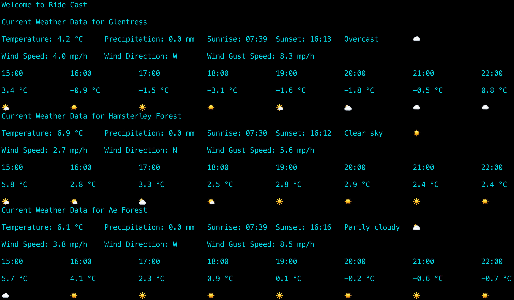

# Ride Cast

A command-line app that compares the weather at three mountain bike parks side by side, so you can choose where to ride. Pick three parks from the list and it shows the current conditions at each, plus an hour-by-hour forecast for the next eight hours.

## Why I built it

Before a ride I'm always checking the weather in three different areas to decide where to go. I also wanted to build something that used a real API, so I made an app that does that comparison for me on one screen. With my recent projects I've tried to take things further and in different directions, and this was my first project working with live data from an API.

## Features

- Choose any three of seven bike parks in the UK and the Alps:
  Glentress, Hamsterley Forest, Ae Forest, Fort William, Bike Park Wales, Revolution Bike Park and Morzine
- Current conditions for each park: temperature, precipitation, wind speed, wind gusts, wind direction, sunrise and sunset
- A plain-English description of the weather with a matching emoji (for example "Partly cloudy ⛅️")
- Wind direction shown as a compass point (N, NE, E…) instead of degrees
- Hourly temperature and weather emoji for the next eight hours
- Checks each menu choice, so anything that isn't on the list asks again

## How it developed

I built it up in stages, adding one idea at a time:

1. **Calling the API.** I started by calling the [Open-Meteo](https://open-meteo.com/) API for one set of coordinates to see what data came back.
2. **Current conditions.** I picked out the useful values and displayed the current weather for that location.
3. **More bike parks.** I stored the coordinates of several bike parks in a dictionary and showed three locations on the same screen to compare.
4. **Weather descriptions.** I noticed the API returns a weather code, so I created a dictionary that matches each code to a description.
5. **Weather emojis.** I added a second